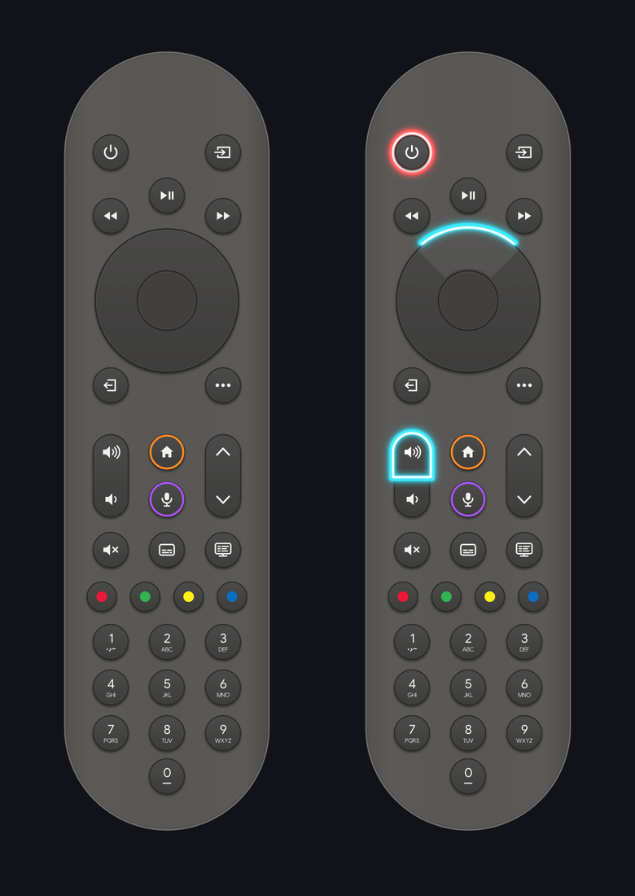

# Bravia Remote Card

A remote control for **Sony BRAVIA TVs** on your Home Assistant dashboard, drawn like a real remote.
It works with the **Bravia TV** and the **Android TV Remote** integrations and sets itself up: add the card and it finds your TV.



## Features

- **Plug and play**: finds your Sony TV and the matching media player by itself, and picks the right commands for the integration in use.
- **35 buttons**: power, input, play/pause, rewind, fast forward, a four-way D-pad with OK, back, options, Home, Assistant, volume, channels, mute, subtitles, TV guide, the four colour keys and the number pad.
- **Glowing feedback**: the pressed button lights up, following its shape. The volume and channel rockers light up as half pills, the D-pad as an arc.
- **Hold to repeat**: arrows, volume and channels repeat while you hold them, with adjustable delay and speed.
- **Power that really works**: the ⏻ button uses the TV's media player, so it can switch the TV on from standby.
- **Visual editor**: choose the TV, the power media player, the size (width and height, with a "keep proportions" switch) and the repeat timing. Every field has an explanation.
- **Scales cleanly**: the remote is a single vector drawing that stays sharp at any size and shrinks on narrow screens.
- English and Italian.

## Requirements

- Home Assistant 2024.11 or newer.
- A Sony BRAVIA TV set up with one of these integrations:
  - [Bravia TV](https://www.home-assistant.io/integrations/braviatv/) (recommended, uses the TV's own IRCC codes)
  - [Android TV Remote](https://www.home-assistant.io/integrations/androidtv_remote/)

## Installation

### Marketplace (recommended)

[](https://my.home-assistant.io/redirect/marketplace_repository/?owner=Sived80&repository=bravia-remote-card&category=plugin)

1. Click the button above, or in Home Assistant go to **Settings** → **Marketplace** and add `https://github.com/Sived80/bravia-remote-card` as a custom repository of type **Dashboard**.
2. Install **Bravia Remote Card**.
3. Reload the browser page.

### Manual

1. Download `bravia-remote-card.js` from the [latest release](https://github.com/Sived80/bravia-remote-card/releases/latest).
2. Copy it to `config/www/bravia-remote-card/bravia-remote-card.js`.
3. In **Settings** → **Dashboards** → **⋮** → **Resources**, add `/local/bravia-remote-card/bravia-remote-card.js` as a **JavaScript module**.
4. Reload the browser page.

## Usage

Add the card from the card picker (**Bravia Remote Card**) or in YAML:

```yaml
type: custom:bravia-remote-card
```

That is all: the card finds your TV. To choose it explicitly:

```yaml
type: custom:bravia-remote-card
entity: remote.living_room_tv
media_player: media_player.living_room_tv
width: 260
```

### Options

| Option | Default | Description |
|---|---|---|
| `entity` | found automatically | The TV's `remote.*` entity (Bravia TV or Android TV Remote). |
| `media_player` | found automatically | Media player used by the ⏻ button to know whether the TV is on and to switch it on or off. Defaults to the media player of the same TV. Do not use a Cast player: it cannot switch the TV on. |
| `width` | `214` | Width in pixels (120–400). The remote shrinks on narrow screens. |
| `height` | follows `width` | Height in pixels (400–1340). Only used when `keep_ratio` is `false`. |
| `keep_ratio` | `true` | Keep the drawing's proportions. When `false`, `width` and `height` are independent and the drawing stretches. |
| `repeat_delay` | `500` | Arrows, volume and channels: how long (ms) a button must be held before it starts repeating. |
| `repeat_interval` | `200` | Once repeating, how often (ms) the command is sent again. 200 ms = 5 times per second. |
| `haptic` | `true` | Short vibration on every press (Home Assistant app). |
| `commands` | — | Override the command of single buttons, e.g. `{ btn-ok: DpadCenter }`. See the button list below. |

### Buttons and commands

| Button | ID | Bravia TV | Android TV Remote | Repeats |
|---|---|---|---|---|
| Power | `btn-power` | media player on/off | media player on/off | |
| Input | `btn-input` | `Input` | `TV_INPUT` | |
| Play / pause | `btn-play-pause` | `PlayPause` | `MEDIA_PLAY_PAUSE` | |
| Rewind / fast forward | `btn-rewind` / `btn-fast-forward` | `Rewind` / `Forward` | `MEDIA_REWIND` / `MEDIA_FAST_FORWARD` | |
| Up, down, left, right | `btn-up` `btn-down` `btn-left` `btn-right` | `Up` `Down` `Left` `Right` | `DPAD_UP` … | ✓ |
| OK | `btn-ok` | `Confirm` | `DPAD_CENTER` | |
| Back / options | `btn-back` / `btn-more` | `Return` / `Options` | `BACK` / `MENU` | |
| Home | `btn-home` | `Home` | `HOME` | |
| Assistant | `btn-voice` | `Assists` | `ASSIST` | |
| Volume + / − | `btn-vol-up` / `btn-vol-down` | `VolumeUp` / `VolumeDown` | `VOLUME_UP` / `VOLUME_DOWN` | ✓ |
| Channel + / − | `btn-ch-up` / `btn-ch-down` | `ChannelUp` / `ChannelDown` | `CHANNEL_UP` / `CHANNEL_DOWN` | ✓ |
| Mute | `btn-mute` | `Mute` | `VOLUME_MUTE` | |
| Subtitles | `btn-subtitles` | `SubTitle` | `CAPTIONS` | |
| TV guide | `btn-tv-guide` | `GGuide` | `GUIDE` | |
| Red, green, yellow, blue | `btn-red` … `btn-blue` | `Red` `Green` `Yellow` `Blue` | `PROG_RED` … | |
| 0–9 | `btn-0` … `btn-9` | `Num0` … `Num9` | `0` … `9` | |

Good to know:

- The **colour keys** do whatever the current screen assigns to them: teletext pages, interactive (HbbTV) services on broadcast channels, shortcuts in the TV guide. Most streaming apps ignore them.
- The **Assistant** key opens the Google Assistant on the TV. Your voice cannot be sent from Home Assistant.
- Your TV can list the IRCC command names it accepts: they are the names to use in `commands` with the Bravia TV integration.

## Development

```bash
npm install
npm run build        # dist/bravia-remote-card.js
npm run typecheck
```

`assets/remote.svg` is generated by `sorgenti/prepara_svg.py` from the original drawing. Every button is an SVG group with a `btn-*` id and its own glow layer.

## License

[MIT](LICENSE). Remote drawing © Sived80.

Sony and BRAVIA are trademarks of Sony Group Corporation. This project is not affiliated with or endorsed by Sony.
